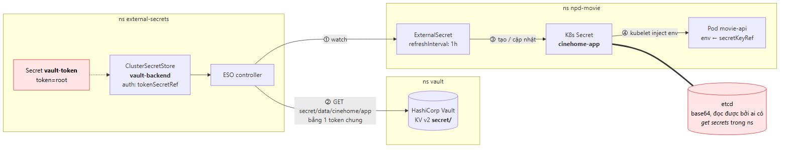
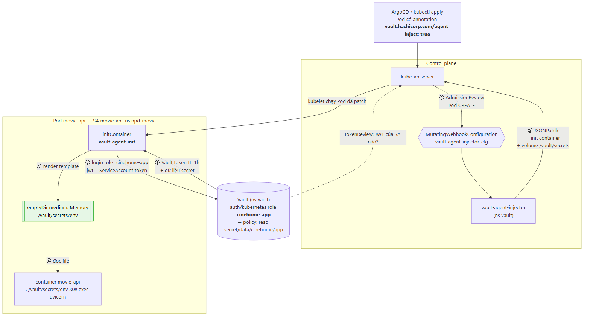
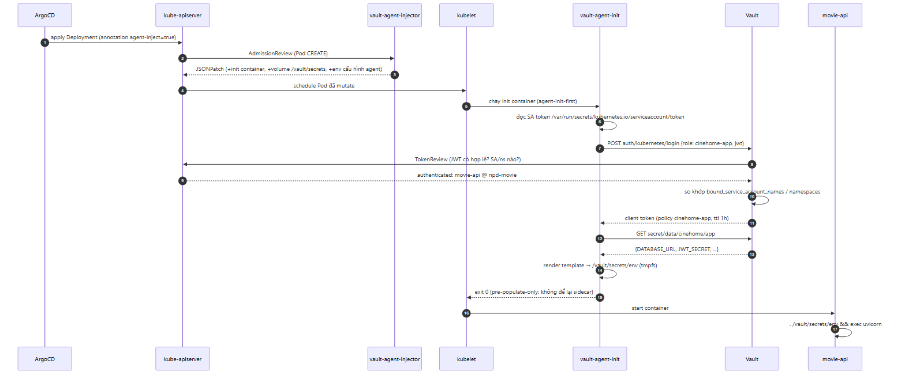
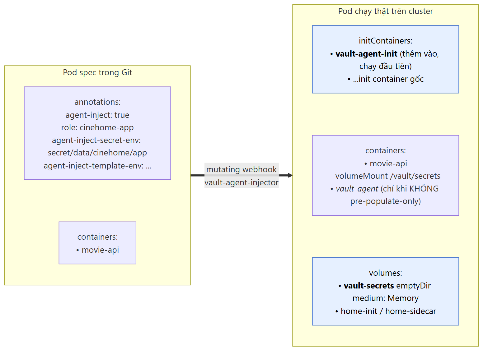

# Vault Agent Injector thay External Secrets Operator: cơ chế hoạt động và vì sao mình đổi

> **Series**: Banking Demo — Full DevOps với Microservices  
> **Bài 11/12**: Secret không còn nằm trong etcd — chuyển từ ESO sang Vault Agent Injector  
> **Repo**: [github.com/kevinram164/cloud-native-platform](https://github.com/kevinram164/cloud-native-platform) (platform), [movie-web](https://github.com/kevinram164/movie-web) (ví dụ app)

---

## Mở đầu

Ở [bài 10](./10-gitops-platform-phase9.md), secret của mọi app đi theo đường **Vault → External Secrets Operator (ESO) → Kubernetes Secret → Pod**. Cách này chạy ổn trên lab OpenShift, nhưng khi dựng lại platform trên cụm kubeadm `dev-k8s`, mình quyết định bỏ hẳn ESO và chuyển sang **Vault Agent Injector**. Đây là thay đổi kiến trúc mình thấy đáng giá nhất của đợt chuyển cụm.

Bài này trả lời ba câu hỏi:

1. Vault Agent Injector hoạt động thế nào, từ lúc `kubectl apply` tới lúc app đọc được mật khẩu?
2. Nó khác ESO ở đâu, được gì và mất gì?
3. Áp dụng vào app thật (CineHome, Grafana, MinIO, cloudflared...) thì phải sửa những gì, và vướng gì?

---

## 1. Kiến trúc cũ: Vault + ESO



ESO là một controller chạy trong cluster. Nó làm đúng một việc: **đọc secret từ hệ thống bên ngoài rồi ghi thành `Secret` của Kubernetes**.

Luồng trên lab OCP:

1. Admin tạo Secret `vault-token` trong namespace `external-secrets`, chứa token để ESO gọi Vault (trên lab là token root).
2. `ClusterSecretStore vault-backend` mô tả cách kết nối Vault và trỏ tới token đó.
3. Mỗi app khai báo một `ExternalSecret`:

```yaml
apiVersion: external-secrets.io/v1beta1
kind: ExternalSecret
metadata:
  name: npd-shop-secrets
spec:
  refreshInterval: 1h
  secretStoreRef:
    name: vault-backend
    kind: ClusterSecretStore
  target:
    name: npd-shop-secrets
  data:
    - secretKey: DATABASE_URL
      remoteRef:
        key: npd-shop/app
        property: DATABASE_URL
```

4. ESO đọc Vault, tạo Secret `npd-shop-secrets`, và cứ mỗi `refreshInterval` lại đồng bộ một lần.
5. Pod dùng Secret như bình thường: `envFrom`, `secretKeyRef` hoặc mount volume.

Ưu điểm lớn nhất: **app không cần biết Vault tồn tại**. Mọi Helm chart có `existingSecret` đều dùng được ngay.

Nhưng càng nhiều app dùng chung, mình càng thấy khó chịu với ba điểm:

| Vấn đề | Chi tiết |
|--------|----------|
| **Secret vẫn nằm trong etcd** | Vault chỉ là "nguồn". Bản sao thật nằm trong etcd dưới dạng base64. Ai có quyền `get secrets` trong namespace là đọc được, backup etcd cũng chứa nó. |
| **Một danh tính đọc tất cả** | ESO dùng một token chung cho mọi namespace. Token đó lộ là lộ toàn bộ `secret/`. Trên lab mình còn dùng token root cho nhanh. |
| **Thêm một tầng phải vận hành** | CRD, controller, `ClusterSecretStore` phải whitelist trong AppProject ArgoCD, thứ tự bootstrap (`vault-token` phải có trước store), và phải `force-sync` ExternalSecret mỗi lần reseed Vault. |

Công bằng mà nói, điểm thứ hai một phần là do cách mình cấu hình: ESO hỗ trợ cả Kubernetes auth và có thể tách nhiều `SecretStore` theo namespace. Nhưng điểm thứ nhất thì không cấu hình được: **bản chất của ESO là tạo ra Kubernetes Secret**.

---

## 2. Vault Agent Injector là gì?

Vault Agent Injector đi theo hướng ngược lại: **không tạo Secret trong Kubernetes, mà đưa secret thẳng vào filesystem của Pod**. Mỗi Pod tự chứng minh danh tính với Vault và chỉ nhận đúng phần secret của mình.

Nó gồm ba mảnh ghép:

| Thành phần | Vai trò |
|------------|---------|
| **Mutating admission webhook** (`vault-agent-injector`) | Chặn mọi request tạo Pod, Pod nào có annotation `vault.hashicorp.com/agent-inject: "true"` thì sửa spec để chèn Vault Agent vào. |
| **Vault Agent** (chạy dạng init container hoặc sidecar trong Pod) | Login Vault, lấy secret, render ra file trong `/vault/secrets/`. |
| **Kubernetes auth method** trong Vault | Cho phép Vault xác minh "Pod này là ServiceAccount nào, namespace nào" và cấp token với policy tương ứng. |

Trên `dev-k8s`, injector được bật ngay trong Application ArgoCD của Vault:

```yaml
# environments/dev-k8s/argocd/applications/platform/vault.yaml
injector:
  enabled: true
  agentDefaults:
    cpuRequest: 50m
    memRequest: 32Mi
    cpuLimit: 250m
    memLimit: 128Mi
```



---

## 3. Cơ chế hoạt động chi tiết

Lấy ví dụ `movie-api` của CineHome. Đây là toàn bộ trình tự từ lúc ArgoCD apply tới lúc process `uvicorn` chạy:



### Bước 1–3: Webhook sửa Pod trước khi nó tồn tại

Khi ArgoCD tạo Deployment, ReplicaSet controller gửi request tạo Pod lên `kube-apiserver`. Trước khi lưu vào etcd, apiserver gọi các **mutating admission webhook** đã đăng ký. Chart Vault đăng ký `MutatingWebhookConfiguration vault-agent-injector-cfg` cho thao tác `CREATE` trên `pods`.

Injector đọc annotation của Pod. Nếu có `agent-inject: "true"`, nó trả về một JSONPatch:



- Thêm init container `vault-agent-init`. Với `agent-init-first: "true"`, nó được đặt **trước** các init container gốc.
- Thêm volume `vault-secrets` kiểu `emptyDir` với `medium: Memory` (tmpfs), mount vào `/vault/secrets` của mọi container.
- Thêm sidecar `vault-agent` **chỉ khi** không đặt `agent-pre-populate-only: "true"`.
- Gắn annotation `vault.hashicorp.com/agent-inject-status: injected` để không inject lặp lại.

Điểm hay: **manifest trong Git không có container Vault nào cả**. Chỉ có annotation, phần còn lại do webhook tự thêm lúc runtime.

Kiểm tra trên cluster:

```bash
kubectl -n npd-movie get pod -l app.kubernetes.io/component=movie-api \
  -o jsonpath='{.items[0].spec.initContainers[*].name}'
# vault-agent-init

kubectl -n npd-movie get pod -l app.kubernetes.io/component=movie-api \
  -o jsonpath='{.items[0].metadata.annotations.vault\.hashicorp\.com/agent-inject-status}'
# injected
```

### Bước 6–11: Pod chứng minh mình là ai (Kubernetes auth)

Đây là phần quan trọng nhất và cũng là khác biệt cốt lõi với ESO.

Mỗi Pod được kubelet mount sẵn token của ServiceAccount tại `/var/run/secrets/kubernetes.io/serviceaccount/token`. Đây là một JWT do apiserver ký. Vault Agent gửi JWT này lên Vault:

```text
POST /v1/auth/kubernetes/login
{ "role": "cinehome-app", "jwt": "<SA token của movie-api>" }
```

Vault không tự giải JWT mà hỏi lại Kubernetes bằng **TokenReview API**: "token này có hợp lệ không, của ServiceAccount nào?". Để gọi được TokenReview, ServiceAccount của Vault cần ClusterRole `system:auth-delegator`; chart Vault đã tạo binding này sẵn (`authDelegator`). Vì Vault chạy trong cùng cluster, cấu hình auth chỉ cần một dòng:

```bash
vault auth enable kubernetes
vault write auth/kubernetes/config kubernetes_host=https://kubernetes.default.svc:443
```

Sau khi apiserver xác nhận "đây là SA `movie-api` trong namespace `npd-movie`", Vault so với role:

```bash
# environments/dev-k8s/scripts/vault-setup-k8s-auth.sh
vault policy write cinehome-app - <<'EOF'
path "secret/data/cinehome/app" { capabilities = ["read"] }
EOF

vault write auth/kubernetes/role/cinehome-app \
  bound_service_account_names=movie-api,media-worker \
  bound_service_account_namespaces=npd-movie \
  policies=cinehome-app ttl=1h
```

Khớp cả tên SA lẫn namespace thì Vault trả về một **client token** gắn policy `cinehome-app`, sống 1 giờ. Token này chỉ đọc được đúng `secret/data/cinehome/app`. `movie-api` không thể đọc secret của banking, và một Pod khác trong `npd-movie` dùng SA `default` cũng không login được role này.

So với ESO: thay vì **một token chung đọc mọi thứ**, giờ là **mỗi workload một danh tính, mỗi danh tính một policy tối thiểu**. Trên `dev-k8s`, script tạo 12 role như vậy cho Jenkins, Keycloak, banking, MinIO, Grafana, Alertmanager, CineHome...

### Bước 12–14: Render template ra file

Có token, agent đọc secret rồi render theo template khai báo trong annotation. Template dùng cú pháp Consul Template. Với KV v2, dữ liệu nằm ở `.Data.data`:

```yaml
annotations:
  vault.hashicorp.com/agent-inject: "true"
  vault.hashicorp.com/agent-init-first: "true"
  vault.hashicorp.com/agent-pre-populate-only: "true"
  vault.hashicorp.com/role: "cinehome-app"
  vault.hashicorp.com/agent-inject-secret-env: "secret/data/cinehome/app"
  vault.hashicorp.com/agent-inject-template-env: |
    {{ with secret "secret/data/cinehome/app" }}
    export DATABASE_URL='{{ .Data.data.DATABASE_URL }}'
    export JWT_SECRET='{{ .Data.data.JWT_SECRET }}'
    {{ end }}
```

Quy ước tên: `agent-inject-secret-<tên>` tạo file `/vault/secrets/<tên>`, `agent-inject-template-<tên>` quyết định nội dung file. Ở đây là `/vault/secrets/env`.

File nằm trên **tmpfs** (RAM của node), không ghi xuống disk, không qua etcd, mất khi Pod bị xoá.

### Bước 15–17: App đọc file

Init container thoát với mã 0, kubelet mới chạy container app. `movie-api` là app FastAPI đọc config từ biến môi trường, nên mình bọc lệnh khởi động:

```yaml
command: ["/bin/sh", "-c"]
args:
  - . /vault/secrets/env && exec uvicorn app.main:app --host 0.0.0.0 --port 8080
```

`exec` để `uvicorn` thay thế shell, thành PID 1, nhận đúng SIGTERM khi Pod bị dừng.

### Init-only hay sidecar?

| | `agent-pre-populate-only: "true"` (init-only) | Sidecar (mặc định) |
|---|---|---|
| Container thêm vào | 1 init container, chạy xong là thoát | Init container + sidecar chạy suốt đời Pod |
| Tài nguyên | Chỉ tốn lúc khởi động | Thêm ~32Mi RAM mỗi Pod, thường trực |
| Đổi secret trong Vault | Phải restart Pod | Agent tự render lại (KV v2 mặc định mỗi 5 phút) |
| Vault down/sealed sau khi Pod đã chạy | Không ảnh hưởng | Sidecar báo lỗi renew, app vẫn giữ file cũ |
| Dùng cho Job | Được | Sidecar không thoát → Job không bao giờ Complete |

Mình chọn **init-only cho toàn bộ workload**. App như `movie-api` đọc env một lần lúc khởi động, sidecar có render lại file thì process cũng không biết. Rotate secret thì `kubectl rollout restart` là đủ, rõ ràng hơn. Job như `movie-db-init` thì bắt buộc init-only.

---

## 4. Áp dụng vào app thật: bốn kiểu đọc secret

Khác biệt lớn nhất khi chuyển từ ESO: **app phải đọc file thay vì env có sẵn**. Mỗi loại app cần một cách khác nhau.

### Kiểu 1: App đọc env → `source` file

Dùng cho `movie-api`, `media-worker`, banking services. Template render dạng `export KEY='value'`, container chạy `. /vault/secrets/env && exec <lệnh gốc>`. Điều kiện: image phải có `/bin/sh`.

### Kiểu 2: App hỗ trợ đọc config từ file

Đây là kiểu sạch nhất vì không phải sửa entrypoint.

Grafana hỗ trợ cú pháp `$__file{}`:

```yaml
auth.generic_oauth:
  client_secret: $__file{/vault/secrets/oidc-client-secret}
```

Bitnami MinIO đọc credential từ file. Annotation `secret-volume-path-<tên>` đổi nơi agent ghi file sang đúng đường dẫn chart mong đợi:

```yaml
vault.hashicorp.com/agent-inject-secret-root-user: "secret/data/platform/minio"
vault.hashicorp.com/secret-volume-path-root-user: "/opt/bitnami/minio/secrets"
```

### Kiểu 3: Image distroless → dùng flag `--*-file`

`cloudflare/cloudflared` là image distroless, không có shell nên không `source` được. May là từ bản 2025.4.0 nó có `--token-file`:

```yaml
vault.hashicorp.com/agent-inject-template-token: |-
  {{- with secret "secret/data/cinehome/cloudflared" -}}
  {{- .Data.data.token -}}
  {{- end -}}
# ...
args: [tunnel, --no-autoupdate, run, --token-file, /vault/secrets/token]
```

Lưu ý dấu `-` trong `{{-` và `-}}`: nó cắt khoảng trắng và xuống dòng, để file chỉ chứa đúng token. Thiếu dấu này, file có ký tự `\n` ở cuối và nhiều app sẽ báo token sai.

### Kiểu 4: Job dùng file trực tiếp

Job `movie-db-init` (ArgoCD PreSync hook, namespace `postgres`) có role riêng `cinehome-db-init`, chỉ đọc được `secret/cinehome/movie-db`. Script trong Job đọc `/vault/secrets/db-password` rồi tạo user và database. Init-only nên Job kết thúc bình thường.

---

## 5. Những chỗ dễ vấp

### Helm nuốt mất template của Vault

Template của Vault (`{{ .Data.data.X }}`) và Helm dùng chung cú pháp `{{ }}`. Đặt annotation trong chart, Helm sẽ cố render trước và báo lỗi. Cách xử lý là bọc phần của Vault trong backtick để Helm in nguyên văn:

```yaml
{{- define "cinehome.vault.podAnnotations" -}}
vault.hashicorp.com/agent-inject-template-env: |
  {{`{{ with secret "`}}{{ $v.appPath }}{{`" }}`}}
  {{- range .keys }}
  export {{ . }}='{{`{{ .Data.data.`}}{{ . }}{{` }}`}}'
  {{- end }}
  {{`{{ end }}`}}
{{- end -}}
```

Helm render `appPath` và danh sách key, còn `{{ with secret ... }}` được giữ nguyên cho Vault Agent. Với chart bên thứ ba có chạy `tpl` trên `podAnnotations` (như Bitnami MinIO) cũng phải bọc tương tự.

### `imagePullSecrets` không thể lấy từ Injector

Kubelet phải pull image **trước khi** bất kỳ container nào chạy, kể cả `vault-agent-init`. Vì vậy credential Harbor bắt buộc phải là Secret `kubernetes.io/dockerconfigjson` có sẵn. Đây là chỗ duy nhất mình vẫn tạo Kubernetes Secret, bằng script đọc từ Vault:

```bash
VAULT_PATH=secret/cinehome/harbor-pull NAMESPACES=npd-movie \
  bash environments/dev-k8s/scripts/create-harbor-pull-secret.sh
```

Tương tự cho các trường hợp Kubernetes cần Secret ở tầng hạ tầng: TLS cho Ingress, credential cho StorageClass...

### Chart chỉ nhận `existingSecret`

Một số chart không có tuỳ chọn đọc file. Bitnami MinIO có `useCredentialsFiles`, nhưng vẫn tự sinh Secret ngẫu nhiên nếu không khai báo `existingSecret`, làm checksum đổi mỗi lần render và Pod restart liên tục. Mình phải khai một tên Secret giả (`existingSecret: minio-vault-managed`) chỉ để tắt tính năng đó. Trước khi chọn Injector cho một chart, nên đọc kỹ template của chart.

### Pod kẹt `Init:0/1`

Đây là lỗi mình gặp nhiều nhất. Init container chưa lấy được secret thì app không bao giờ chạy. Luôn xem log init container trước:

```bash
kubectl -n npd-movie logs deploy/movie-api -c vault-agent-init
```

| Log | Nguyên nhân | Cách sửa |
|-----|-------------|----------|
| `invalid role name "cinehome-app"` | Role chưa được tạo trong Vault | Chạy lại `vault-setup-k8s-auth.sh` |
| `permission denied` khi login | SA hoặc namespace của Pod không khớp `bound_service_account_*` | Kiểm tra `serviceAccountName` trong manifest |
| `permission denied` khi đọc secret | Policy thiếu path, hay gặp nhất là quên `data/` của KV v2 | Path policy phải là `secret/data/...` |
| `Vault is sealed` / connection refused | Vault restart và chưa unseal | `vault operator unseal` (3/5 key) |
| Secret path không tồn tại | Chưa seed Vault | `vault kv put secret/...`; script setup có vòng kiểm tra `OK / MISSING` |

Một trường hợp ngược lại: Pod chạy nhưng container crash với `/vault/secrets/env: No such file or directory`. Nghĩa là **webhook không inject**: sai chính tả annotation, đặt annotation ở `metadata` của Deployment thay vì `spec.template.metadata`, hoặc injector đang down. Chart Vault mặc định `failurePolicy: Ignore`, nên khi injector down, Pod vẫn được tạo nhưng không có agent.

### Vault trở thành phụ thuộc lúc khởi động

Với ESO, Vault down thì Secret cũ vẫn nằm trong etcd, Pod mới vẫn start được. Với Injector, **Vault sealed là mọi Pod mới đều kẹt Init**, kể cả Pod chỉ bị reschedule do node restart. Trên lab, Vault dùng file storage và unseal tay, nên sau mỗi lần restart Vault, unseal là việc đầu tiên phải làm. Môi trường production nên chạy Vault HA (Raft) với auto-unseal.

---

## 6. So sánh tổng hợp

| Tiêu chí | ESO | Vault Agent Injector |
|----------|-----|----------------------|
| Secret nằm ở đâu | Vault **và** Kubernetes Secret trong etcd | Chỉ Vault, cộng tmpfs trong Pod đang chạy |
| Ai đọc được | Mọi subject có `get secrets` trong namespace | Chỉ process trong Pod đó |
| Danh tính gọi Vault | Một danh tính của ESO (trên lab: token chung) | Mỗi ServiceAccount một role, một policy |
| Audit trên Vault | Chỉ thấy ESO đọc | Thấy từng role / workload đọc |
| Thay đổi app | Không cần | Phải đọc file (source env, `$__file`, `--*-file`) |
| Helm chart có sẵn | Dùng `existingSecret` là xong | Tuỳ chart, có khi phải lách |
| `imagePullSecrets`, TLS Ingress | Làm được | Không làm được, vẫn cần Secret |
| Vault down | Pod mới vẫn start bằng Secret cũ | Pod mới kẹt Init |
| Rotate secret | ESO tự sync; env vẫn cần restart Pod | Init-only: restart Pod; sidecar: tự render lại |
| Thành phần thêm | Controller + CRD + SecretStore | Webhook (đi kèm chart Vault) + agent trong mỗi Pod |
| Tài nguyên mỗi Pod | Không | Init container lúc start (thêm sidecar nếu dùng) |
| Hỗ trợ backend khác | AWS SM, GCP SM, Azure KV... | Chỉ Vault |

---

## 7. Khi nào chọn cái nào?

**Chọn Vault Agent Injector khi:**

- Vault là nguồn secret duy nhất.
- Bạn muốn secret **không bao giờ** xuất hiện dưới dạng Kubernetes Secret.
- Cần phân quyền theo từng workload và audit được ai đọc gì.
- Phần lớn app là code của mình, sửa entrypoint được.

**Chọn ESO khi:**

- Dùng nhiều secret backend (cloud secret manager, 1Password...).
- Nhiều chart bên thứ ba chỉ nhận `existingSecret`.
- Cần Secret cho tầng hạ tầng: TLS, pull secret, StorageClass.
- Không muốn Pod phụ thuộc vào Vault lúc khởi động.

Hai cách không loại trừ nhau. Trên `dev-k8s`, mình dùng Injector cho mọi secret ứng dụng, và một script nhỏ cho đúng một loại Secret bắt buộc là `harbor-pull-creds`. Nếu số trường hợp "bắt buộc phải là Secret" tăng lên, chạy thêm ESO **với Kubernetes auth** chỉ cho các trường hợp đó vẫn là lựa chọn hợp lý.

Ngoài ra HashiCorp còn có **Vault Secrets Operator (VSO)** và **Vault CSI Provider**. VSO hoạt động giống ESO (đồng bộ ra Kubernetes Secret) nhưng chỉ cho Vault. CSI Provider mount secret dạng volume và không cần webhook. Mình chưa dùng hai cái này trong lab.

---

## Kết luận

Chuyển từ ESO sang Vault Agent Injector không làm hệ thống đơn giản hơn: app phải sửa cách đọc config, chart phải lách, và Vault trở thành thứ phải chạy trước mọi Pod. Đổi lại, mình có được ba thứ quan trọng:

1. **Secret ứng dụng không còn nằm trong etcd.** Không ai `kubectl get secret -o yaml` ra được mật khẩu database của CineHome.
2. **Least privilege thật sự.** `movie-api` chỉ đọc được `cinehome/app`, Job `movie-db-init` chỉ đọc được `cinehome/movie-db`, cloudflared chỉ đọc được token tunnel.
3. **Bớt một controller và một bộ CRD** phải vận hành và whitelist trong ArgoCD.

Với một platform dùng chung cho nhiều app (banking, shop, CineHome, AIOps), mình thấy cái giá đó đáng trả.

**Tài liệu liên quan trong repo:**

| File | Nội dung |
|------|----------|
| `cloud-native-platform/.../dev-k8s/scripts/vault-setup-k8s-auth.sh` | KV v2, Kubernetes auth, toàn bộ policy và role |
| `cloud-native-platform/.../dev-k8s/scripts/create-harbor-pull-secret.sh` | Pull secret Harbor từ Vault |
| `movie-web/charts/movie/templates/_helpers.tpl` | Helper annotation Vault cho Helm |
| `movie-web/deploy/dev-k8s/manifests/cloudflared/deployment.yaml` | Ví dụ image distroless với `--token-file` |

**Bài tiếp theo (dự kiến):** observability cho CineHome — đo trải nghiệm xem phim từ player tới disk NFS.
